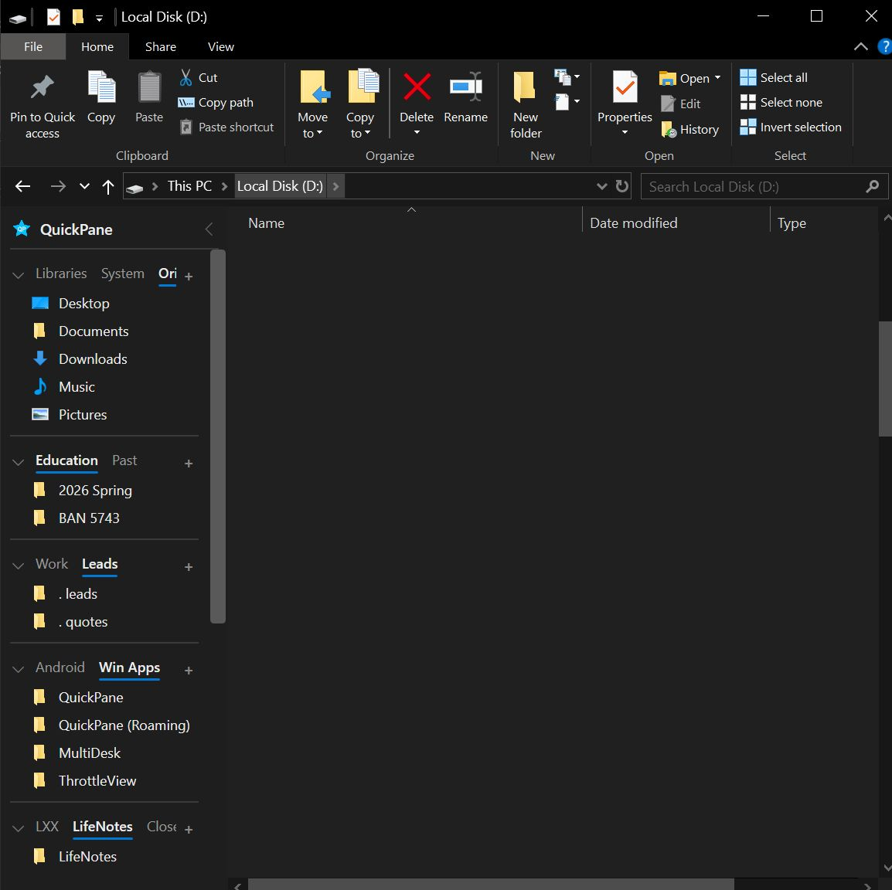
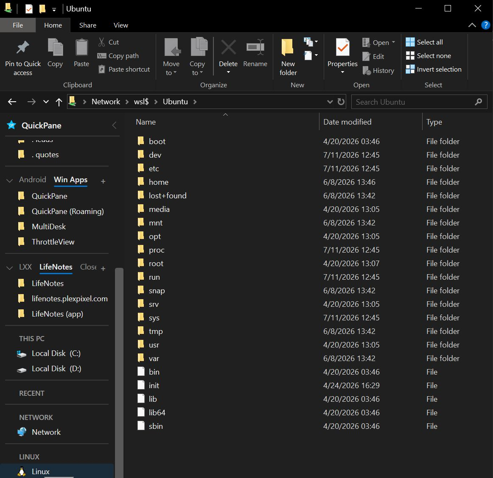
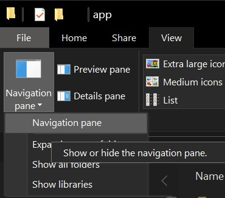

# QuickPane


A folder sidebar for Windows File Explorer. QuickPane embeds a pinned-folders pane inside every Explorer window, so your groups, recent locations, drives, network shares, and WSL distros travel with the window you are already using. Pin it inside the window, float it beside the window, or run it as a slim screen-edge dock. Everything runs locally as a single tray app, no code is ever injected into Explorer, and all data stays in plain files under your user profile.



## Summary

Your folders are one click away inside Explorer itself, with:

- **Inside, beside, or dock**: embed the pane in each Explorer window and shift its content, float a follower pane at the window's edge, or run dock-only
- **Pinned folder groups**: organize folders into groups and tabs, backed by real folders and shortcuts on disk
- **Real Recent**: the folders you browse in Explorer, including those opened outside the pane
- **This PC, Network, and Linux**: expandable drives and lazy folder trees, plus Network and WSL sections
- **Window z-level**: the beside pane is an owned window of its Explorer window and is drawn at that window's z-level
- **Desktop dock**: an optional screen-edge AppBar with auto-hide and all-virtual-desktops pinning
- **Open and Save dialog support**: the pane attaches to file dialogs and navigates them too
- **Search box**: filters every folder in the pane as you type
- **Recent Apps**: the programs you have been using. Clicking a row opens its app, and browser rows expand into their profiles
- **Per-app folders**: set a folder as an app's starting point for its Save and Open dialogs
- **Profiles**: independent workspaces, each with its own groups, recents count, and width
- **Native feel**: dark and light themes matched to the Windows shell
- **Local storage**: groups are folders of shortcuts and settings are a JSON file you can back up

## Features

### Inside, beside, and dock modes

Three ways to show the pane, chosen in Settings:

- **Inside** places the pane inside each Explorer window and shifts the file view right by the pane width.
- **Beside** places a follower pane against the left edge of each window and leaves the window's content in place. As an owned window of its Explorer window, the pane is drawn at that window's z-level, appears on that window's virtual desktop, and is hidden when the window is minimized.
- **Off** uses only the desktop dock and leaves Explorer windows untouched.

### Pinned folder groups

Folders are pinned in groups, and a group can hold several tabs.

- Pin a folder from the **Pin to Quick Pane** context-menu verb on any folder, from the folder background, or by dragging it into the pane
- Create, rename, and delete groups, tabs, and pins
- Drag to reorder groups, tabs, and pins, with a visible drop line while reordering
- Drag one group onto another to merge their tabs, or drag a tab into empty space to make it a new group
- Drop a pin, or a folder from Explorer, on a tab button to place it in that tab
- A group with a single tab shows a plain list, and a group with several tabs shows a horizontally scrollable tab row
- A default group with your library and system folders appears on first run

### Sections

The pane is a stack of sections you can show, hide, reorder, and rename:

- **Search box**: filters the rows on screen as you type
- **App Folders**: inside a file dialog, the folder you set as that app's starting point
- **Groups**: your pinned folder groups
- **Recent**: folders browsed directly in Explorer, captured through window activation, title changes, and a light periodic check, with a location-URL fallback when the shell returns nothing, and a configurable count from 5 to 50
- **This PC**: a This PC row that opens the folder and expands to the drives, each drive expanding into subtrees that enumerate lazily like the native Explorer tree
- **Network** and **Linux (WSL)**: separate sections, each with a visibility toggle, that expand into the computers and distros Windows lists
- **Recent Apps**: the programs you have been using, each opening its app



### Native file drag

Drag files from Explorer onto a pinned folder to file them. Dropping moves on the same drive and copies across drives, while Ctrl forces a copy, Shift forces a move, and Alt creates a shortcut. The shell runs the operation, with Explorer's own progress, conflict, and undo handling.

### Desktop dock

An optional AppBar at the left screen edge, independent of the window pane.

- Auto-hide collapses it to a thin strip that expands on hover
- A setting shows it on every virtual desktop
- Clicking a folder navigates the active Explorer window and brings it forward, or opens a new window when none is open

### Open and Save dialog support

QuickPane attaches to file Open and Save common dialogs and honors the same pane mode as real windows. Inside mode widens the dialog and shifts each of its controls right by the pane width. Beside mode places a pane against the dialog's left edge. Clicking a folder navigates both the classic dialog and the modern common item dialog.

- A dialog too wide for the inside pane gets a beside pane, and the dialog is moved or narrowed to make room
- An app whose dialogs move their controls back over the inside pane is added to the dialog beside list, which is kept across restarts
- **Clear the dialog beside list**, under Troubleshooting in the tray menu, gives every app the inside pane again

### Search

A box at the top of the pane filters the rows on screen as you type.

- A heading disappears along with the rows beneath it
- A folder stays visible when something inside it matches
- Escape clears the box

### Recent Apps

The programs you have been using. Clicking a row opens its app. An app is added to the list when it is brought to the front or when its Save or Open dialog is used, and Settings has an option for which of the two count.

- Browser rows expand into the profiles listed in the browser's own profile file
- Chromium-family browsers and Firefox are both read
- Each program row has the name and icon Windows uses for it, and side-by-side installs such as Chrome and Chrome Canary have separate rows
- The folder an app's dialog was last sent to is on the row's right-click menu

### Per-app folders

Right-click a folder while an app's Save or Open dialog is open and choose "Always start {app} here". The folder then appears in an App Folders section at the top of the pane in that app's dialogs.

### Keyboard navigation

An optional shortcut moves focus into the pane, where the arrow keys move between folders and Enter opens one. The shortcut is off by default and is switched on under Settings, Hotkeys.

### Profiles

Each profile is an independent workspace with its own groups folder, recents count, and sidebar width.

- Switch profiles from the tray icon's right-click menu or from the profile tab row under the title
- The profile tab row can auto-hide and expands when the cursor is over the header
- Manage profiles in a multi-column settings layout with add, remove, and rename
- Drag a group between profile columns to move it, or hold Ctrl to drop a copy into the other profile

### Remembered layout

The open or closed state of section headers, groups, and folder subtrees is saved, keyed by section type, group folder, and tree path. It is restored after pane rebuilds, profile switches, window switches, and restarts.

### Collapsible pane and appearance

- Clicking the chevron in the title header collapses the pane to a thin strip, or toggles auto-hide on the desktop dock
- Dark and light themes, applied live
- Adjustable pane width from 160 to 400 px, dragged from the inner edge
- Settings apply live with no Apply button

## Requirements

- **Windows 10 or Windows 11**, 64-bit (developed and tested on Windows 10 LTSC)
- **.NET Framework 4.8** runtime (preinstalled on current Windows)
- To build from source: **Visual Studio 2019/2022** with the .NET Framework 4.8 targeting pack
- To build the installer: **[Inno Setup](https://jrsoftware.org/isinfo.php)** 6+

## Installation

### Option A: Run a release build

1. Download the latest `QuickPaneSetup-<version>-release.exe` from the Releases page (or build it yourself below)
2. Run the installer. It installs per-user with no administrator rights, registers the **Pin to Quick Pane** folder verb, adds a startup entry, and launches QuickPane
3. Open any Explorer window and the pane appears inside it

### Option B: Build from source

```bash
git clone https://github.com/lso2/QuickPane.git
```

**Build the app**

1. Open `QuickPane.sln` in Visual Studio
2. Select the **Release | x64** configuration (x64 only)
3. Build the solution. The executable is produced at `QuickPane\bin\x64\Release\QuickPane.exe`
4. Run `QuickPane.exe`

**Build the installer (optional)**

1. Build the app first so `QuickPane.exe` exists at the path referenced in `[Files]`
2. Open `Installer.iss` in Inno Setup and press **Compile**
3. `QuickPaneSetup-<version>-release.exe` is written to the `Output` folder one level above the repository folder

> The installer's `[Files]` source is the `Release\x64` output. If you build `Debug`, change `Release` to `Debug` in `Installer.iss`.

### Recommended: hide Explorer's own navigation pane

Windows' built-in navigation pane is shown next to QuickPane until you turn it off. In any Explorer window, open the **View** tab, click **Navigation pane**, and uncheck **Navigation pane**. QuickPane is then the only tree on the left.



## Usage

### Pinning folders

- Right-click any folder in Explorer and choose **Pin to Quick Pane**, or right-click inside a folder's empty background, or drag a folder into the pane
- Click a pinned folder to navigate the current Explorer window to it
- Middle-click a folder to open it in a new Explorer window. With QTTabBar's window capture on, the window appears as a new tab

### Groups and tabs

- Drag a group, tab, or pin to reorder it
- Drag one group onto another to merge their tabs
- Drag a tab into empty space to split it into a new group
- Drop a pin, or a folder from Explorer, on a tab button to place it in that tab
- Right-click a group or section header to rename it

### Choosing a mode

- Open Settings and pick **Inside**, **Beside**, or **Off** under Pane mode
- Enable the **Desktop dock** for a screen-edge bar available in any mode

### Profiles

- Switch from the tray menu or the profile tab row under the title
- Add, rename, remove, and move groups between profiles in the Settings window

### Settings

- Open Settings from the tray icon or the gear in the pane
- Grouped into tabs: Groups, Pane, Hotkeys, Connections and Backup
- Adjust mode, theme, pane width, recents count, section visibility and order, the desktop dock and its options, the profile tab row, which apps Recent Apps lists, the keyboard shortcut, and profiles
- A footer shows the running version and a Download button when a newer release is published
- Changes apply live

## Settings and data

All data is stored locally under your user profile:

```
%APPDATA%\QuickPane\
├── settings.json        # All settings, sections, dock options, and profiles
├── Groups\              # Groups, tabs, and pinned shortcuts of the first profile
├── Profiles\            # Groups folders of the other profiles
├── uistate.txt          # Remembered open/closed state of sections, groups, and trees
├── recent.txt           # Recent folders
├── recentapps.txt       # Recent Apps
├── besideapps.txt       # Apps whose Save and Open dialogs open with a beside pane
└── Logs\                # debug.log, events.log, and the session heartbeat
```

Groups are stored as ordinary folders: a **group** is a folder under `Groups\`, a **tab** is a subfolder, and a **pin** is a `.lnk` shortcut. You can back up, edit, or rearrange the `Groups` tree directly and QuickPane reflects it.

### Privacy

- **No cloud sync**: everything stays on your computer
- **No accounts**: no login or registration
- **No telemetry**: the one network request is the latest-release check on api.github.com behind the Settings footer
- **Readable formats**: a JSON settings file and ordinary Windows shortcuts you can open and back up anywhere

### settings.json format

```json
{
  "groupsPath": "%APPDATA%\\QuickPane\\Groups",
  "sections": [
    { "type": "groups",   "visible": true, "order": 0 },
    { "type": "recents",  "visible": true, "order": 1 },
    { "type": "computer", "visible": true, "order": 2 },
    { "type": "network",  "visible": true, "order": 3 },
    { "type": "linux",    "visible": true, "order": 4 }
  ],
  "recentsMaxCount": 15,
  "sidebarWidthPx": 220,
  "mode": "inside",
  "desktopDock": false,
  "desktopDockAutoHide": true,
  "desktopDockAllDesktops": false,
  "profiles": [
    { "name": "Profile 1", "groupsPath": "%APPDATA%\\QuickPane\\Groups", "recentsMaxCount": 15, "sidebarWidthPx": 220 }
  ],
  "activeProfile": 0,
  "showProfileTabs": true,
  "profileTabsAutoHide": false
}
```

## Compatibility

| OS | Supported | Notes |
|----|-----------|-------|
| Windows 11 | Yes | Full support |
| Windows 10 (incl. LTSC) | Yes | Developed and tested here |
| Windows 8.1 | Untested | Not tested |
| Windows 7 | Untested | Not tested |
| macOS / Linux | No | Windows-only (Win32 + WPF) |

## Troubleshooting

### The pane is not showing in Explorer windows

Set Pane mode to **Inside** or **Beside** in Settings. A new window shows the pane once Windows has presented it and laid out its toolbar, with no resize needed.

### A Save dialog saves to the wrong place when I click a folder

QuickPane navigates a file dialog through its address bar, and clicking a folder changes the location without saving. A dialog with no usable address bar is navigated through its File name box with the folder path. A dialog that moves its controls back over the inside pane gets a beside pane.

### A Save or Open dialog shows no pane

A dialog too wide for the inside pane gets a beside pane, and the dialog is moved right or narrowed to make room. To give an app's dialogs the inside pane again, use **Clear the dialog beside list** under Troubleshooting in the tray menu.

### An Explorer window looks shifted after QuickPane closes

Closing QuickPane restores each window's content view to full width. If a window was mid-load when QuickPane exited, open a new window and it will be normal.

### Build errors about C# syntax

The project uses the C# 7.3 language version that is the default for .NET Framework 4.8. Build with the .NET Framework 4.8 toolchain and the project's target framework unchanged.

## How it works

QuickPane is a tray application built on WPF and documented Win32 interop, plus one undocumented shell service for pinning the dock to every virtual desktop. With no code inside `explorer.exe`, a fault in QuickPane cannot take Explorer down. The core ideas:

- **SetWinEventHook** out of process discovers Explorer folder windows and tracks them as they are created, shown, moved, activated, and destroyed
- **Inside mode** reparents a WPF `HwndSource` as a `WS_CHILD` of the `CabinetWClass` window and shifts Explorer's content host (`ShellTabWindowClass`) to the right. A readiness gate holds the shift until the window is presented and its toolbar has laid out, and the pane is shown only then
- **A short burst**: Explorer resets its content to full width when a window opens or is activated, and a short burst of repositioning runs at those two moments. Location events alone hold the split during a resize
- **Beside mode** sets the Explorer window as the pane's owner through `GWLP_HWNDPARENT`. Windows then draws the pane at that window's z-level and on its virtual desktop
- **File dialogs** are detected as a `#32770` carrying a `ComboBoxEx32` (classic comdlg32) or a `SHELLDLL_DefView` (modern common item dialog). The desktop window also contains a `SHELLDLL_DefView`, and the `#32770` requirement excludes it
- **The desktop dock** reserves the screen edge with `SHAppBarMessage` and is pinned to every virtual desktop through the shell's undocumented pinned-apps service (`IVirtualDesktopPinnedApps`), the service behind Task View's "Show this window on all desktops"
- **Groups on disk** are folders of `.lnk` shortcuts, read and written through the shell's `IShellLink`
- **Settings** serialize to JSON with `DataContractJsonSerializer` through atomic temp-then-replace writes, and older files are migrated in place. The remembered open/closed state is stored in `uistate.txt`

## Project structure

```
QuickPane/
├── QuickPane.sln              # Visual Studio solution
├── Installer.iss              # Inno Setup installer script
├── CHANGELOG.md               # Version history
├── docs/notes/                # Per-file notes: measurements and decisions
├── screens/                   # Screenshots used in this README
└── QuickPane/
    ├── QuickPane.csproj       # Project (.NET Framework 4.8, x64, WPF)
    ├── app.manifest           # Per-monitor DPI, runs without elevation
    ├── App.xaml(.cs)          # Tray host and service startup
    ├── Interop/
    │   ├── NativeMethods.cs   # All Win32 P/Invoke
    │   ├── WinEventHook.cs    # Out-of-process window-event hooks
    │   ├── ExplorerNavigator.cs # Navigate a real Explorer window
    │   ├── DialogNavigator.cs # Detect and navigate file dialogs
    │   └── VirtualDesktop.cs  # Virtual-desktop queries and pinning
    ├── Explorer/
    │   ├── ExplorerWatcher.cs # Discovers windows, drives layout, burst enforcer
    │   ├── ExplorerWindow.cs  # One embedded (inside) pane and its content shift
    │   ├── ExplorerFollowerWatcher.cs # Beside-mode follower panes
    │   ├── DialogPaneWatcher.cs # Panes for Open/Save dialogs
    │   ├── DialogInsidePane.cs # Inside-mode pane for a dialog
    │   ├── RecentTracker.cs   # Capture real Explorer navigation
    │   └── AppBarHost.cs      # Desktop dock AppBar
    ├── Models/
    │   └── Models.cs          # Settings, profiles, and pinned-folder models
    ├── Services/
    │   ├── SettingsStore.cs   # JSON load, save, migrate
    │   ├── GroupStore.cs      # Loads groups, tabs, and pins from disk
    │   ├── GroupStore.Edits.cs # Group, tab, and pin edits
    │   ├── GroupStore.Profiles.cs # Group folders across profiles
    │   ├── ShellFolders.cs    # Network, WSL, and server folder lists
    │   ├── BesideApps.cs      # Stored dialog beside list
    │   ├── UiState.cs         # Persistent open/closed state
    │   ├── RecentFoldersService.cs # Recent list model
    │   ├── DriveService.cs    # Drive and tree enumeration
    │   ├── KnownFolders.cs    # Known-folder resolution
    │   ├── ShellLink.cs       # Read and write .lnk shortcuts
    │   ├── FileDropOps.cs     # Shell move/copy/shortcut drops
    │   ├── ThemeService.cs    # Dark / light theming
    │   └── Log.cs
    └── UI/
        ├── SidebarControl.xaml(.cs)  # The pane shell
        ├── GroupSection.xaml(.cs)    # Groups section rows
        ├── GroupSection.Drop.cs      # Groups drag and drop
        ├── GroupSection.Menus.cs     # Groups right-click menus
        ├── ComputerSection.xaml(.cs) # This PC, drives, trees
        ├── RecentsSection.xaml(.cs)  # Recent folders
        ├── ShellRootSection.cs       # Network and Linux roots
        ├── FolderItem.xaml(.cs)      # One folder row
        ├── FolderTreeNode.cs         # A lazy tree node
        ├── SettingsPanel.xaml(.cs)   # Settings
        ├── GroupPickerWindow.xaml(.cs) # Pick a group when pinning
        ├── TextPrompt.cs             # Top-level prompts for text entry
        ├── DropLineAdorner.cs        # Reorder drop line
        └── DragGhostAdorner.cs       # Drag ghost
```

## Contributing

1. Fork the repository
2. Create a feature branch (`git checkout -b feature/your-feature`)
3. Make your changes (keep to documented Win32 and the existing C# 7.3 / .NET Framework 4.8 target)
4. Build and test on Windows 10 or 11
5. Commit your changes (`git commit -m 'Add your feature'`)
6. Push to the branch (`git push origin feature/your-feature`)
7. Open a Pull Request

## Author

PlexPixel ([plexpixel.com](https://plexpixel.com))

## License

Copyright (C) 2026 PlexPixel

QuickPane is licensed under the GNU General Public License version 3 (GPL-3.0-only). The full text is in [LICENSE](LICENSE). Sections 15 and 16 of the license disclaim any warranty and limit liability.

---

**If QuickPane is useful to you, please star the repository.**

## Buy me a coffee

If QuickPane saves you time every day, you can support its development.

[](https://plexpixel.com/donate)

**Funding priorities**

- Continued development
- New features and modes
- Faster fixes and updates
- Better documentation

---

*Made for people who spend their day in File Explorer.*
